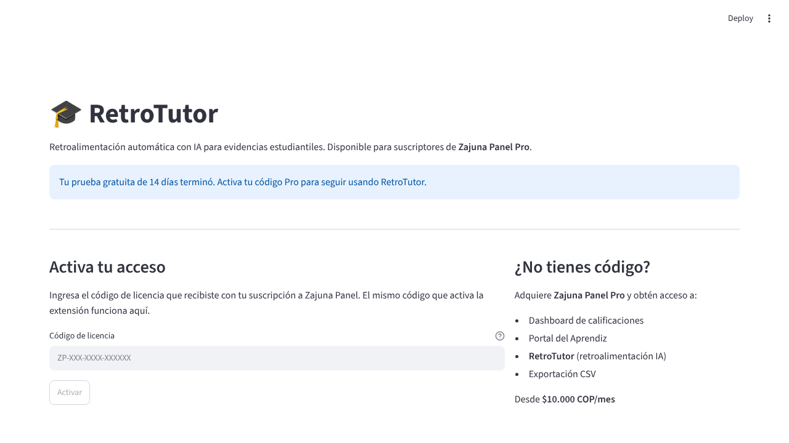
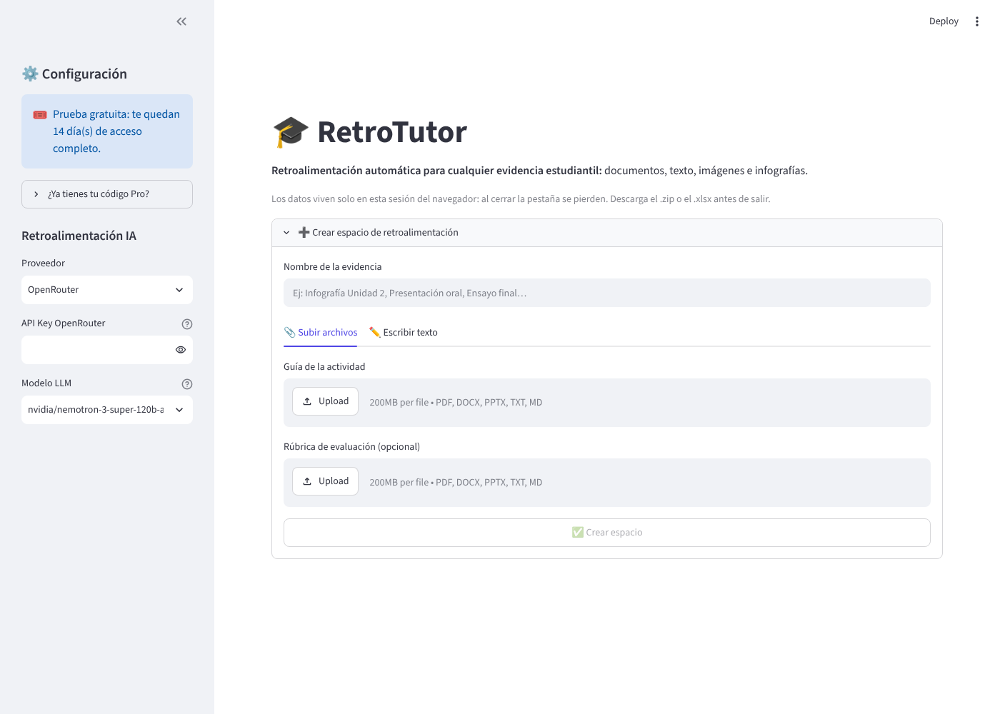
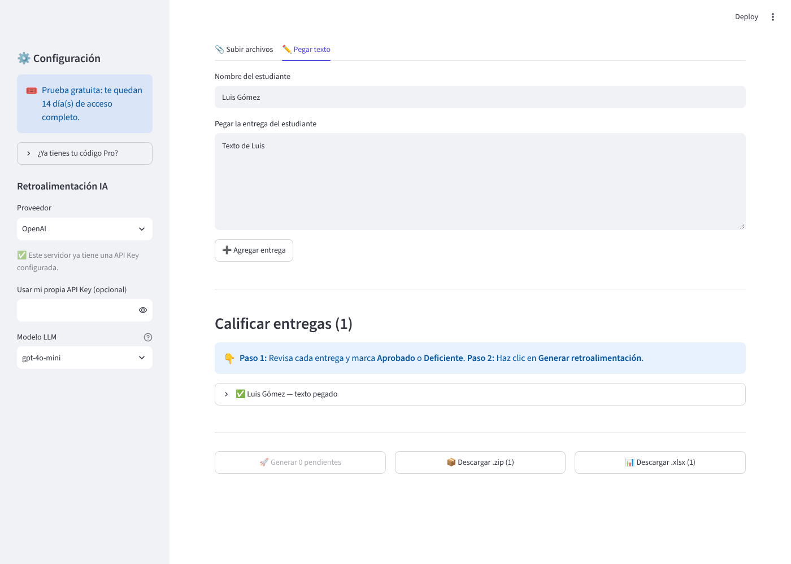

# 🎓 RetroTutor

**Retroalimentación personalizada con IA para evidencias de aprendices, en minutos y no en noches.**

RetroTutor nació para instructores del SENA y docentes que califican decenas de evidencias por ficha y tienen que escribir una retroalimentación distinta para cada aprendiz. El instructor sigue decidiendo si la evidencia se **aprueba** o es **deficiente**; RetroTutor redacta el comentario personalizado (máximo 150 palabras, en español) usando la guía de aprendizaje, la rúbrica y lo que entregó cada aprendiz.

## Qué problema resuelve

| Hoy, a mano | Con RetroTutor |
|---|---|
| Leer la evidencia, abrir la rúbrica y redactar un comentario por aprendiz | Subir todas las evidencias juntas y marcar Aprobado o Deficiente |
| Comentarios genéricos ("Buen trabajo") por falta de tiempo | Comentario específico con lo que hizo bien, dos sugerencias concretas y un cierre motivador |
| Copiar y pegar uno por uno | Exportar todo en **.xlsx** (una fila por aprendiz) o en **.zip** (un .txt por aprendiz) |

El veredicto sigue siendo del instructor. La IA no califica: redacta.

## Flujo de uso

1. **Crear un espacio** por evidencia (ej. "Ensayo Unidad 2"): subir o pegar la **guía de la actividad** y, si se quiere, la **rúbrica** (PDF, DOCX, PPTX, TXT o MD).
2. **Agregar entregas**: subir varios archivos a la vez (PDF, DOCX, PPTX, TXT, imágenes PNG/JPG con OCR) o pegar texto. El nombre del archivo se usa como nombre del aprendiz (`Ana_Perez.pdf` → "Ana Perez") y se puede corregir.
3. **Marcar el veredicto** de cada entrega (Aprobado o Deficiente) y, si se quiere, agregar observaciones. En las imágenes conviene describir lo que se ve, porque la IA solo lee el texto que saca el OCR.
4. **Generar** una por una o todas las pendientes de una vez. Cada retroalimentación se puede **editar** antes de exportar.
5. **Descargar** el .xlsx o el .zip y pegarlo en la plataforma (Zajuna, Territorium, Moodle, etc.).

| Activación | Inicio | Espacio de evidencia |
|---|---|---|
|  |  |  |

> Los datos viven **solo en la sesión del navegador**: no hay base de datos. Al cerrar la pestaña se pierden, así que hay que descargar el .xlsx o el .zip antes de salir.

## Acceso: prueba gratuita y licencia Pro

- **Prueba gratuita de 14 días**, automática en la primera visita y sin pedir código. El inicio de la prueba se guarda en una cookie del navegador.
- **Licencia Pro**: códigos `ZP-XXX-XXXX-XXXXXX` firmados con HMAC-SHA256 y compatibles con **Zajuna Panel** (el mismo código activa la extensión y esta app). El código queda guardado en el navegador para no pedirlo en cada visita.

## Requisitos y servicios externos

| Qué | Para qué | ¿Obligatorio? |
|---|---|---|
| Python 3.11 o superior | Ejecutar la app | Sí |
| Proveedor de IA: **Claude** de [Anthropic](https://console.anthropic.com) (modelo `claude-haiku-5-5`), [OpenRouter](https://openrouter.ai) (tiene modelos gratuitos) u [OpenAI](https://platform.openai.com) | Redactar la retroalimentación | Sí, con la clave del instructor o una del servidor |
| `ZP_SECRET` | Validar códigos Pro (el mismo secreto de Zajuna Panel) | Solo para activar Pro. Sin él, la prueba gratuita funciona y la activación Pro queda deshabilitada |
| Tesseract OCR (`tesseract-ocr`, `tesseract-ocr-spa`) | Leer texto de imágenes | Opcional: sin él, las imágenes se aceptan pero sin texto extraído |
| Base de datos | — | No usa |

### Variables de entorno / secretos

Se leen de variables de entorno o de `.streamlit/secrets.toml` (ver [`.streamlit/secrets.toml.example`](.streamlit/secrets.toml.example)). **Nunca se escriben en el código.** `secrets.toml` está en `.gitignore`.

| Variable | Descripción |
|---|---|
| `ZP_SECRET` | Secreto HMAC para validar los códigos Pro |
| `ANTHROPIC_API_KEY` | *(Opcional)* Clave del servidor para Claude. Si existe, el instructor no tiene que pegar la suya y Claude queda como proveedor por defecto |
| `OPENROUTER_API_KEY` | *(Opcional)* Igual, para OpenRouter |
| `OPENAI_API_KEY` | *(Opcional)* Igual, para OpenAI |

Si no hay clave del servidor, cada instructor pega la suya en la barra lateral. Esa clave se usa solo durante la sesión y no se guarda.

## Instalación local

```bash
git clone https://github.com/jcamiloperez1980-glitch/retrotutor-cloud.git
```

```bash
cd retrotutor-cloud
```

```bash
python -m venv .venv && source .venv/bin/activate
```

```bash
pip install -r requirements-dev.txt
```

```bash
cp .streamlit/secrets.toml.example .streamlit/secrets.toml
```

Edita `.streamlit/secrets.toml` con tu `ZP_SECRET` (y si quieres, una clave de IA). Para el OCR en Debian/Ubuntu:

```bash
sudo apt install tesseract-ocr tesseract-ocr-spa
```

Ejecutar:

```bash
streamlit run app.py
```

Abre http://localhost:8501. También funciona en **GitHub Codespaces** con la carpeta `.devcontainer/` incluida.

### Pruebas

```bash
pytest
```

Las pruebas cubren la validación de licencias, la prueba gratuita, la extracción de texto (DOCX, PPTX, PDF dañado), la construcción del prompt, la llamada al modelo (con un cliente simulado) y las exportaciones .zip y .xlsx.

## Despliegue en Streamlit Community Cloud

1. Entra a [share.streamlit.io](https://share.streamlit.io) con la cuenta de GitHub y elige **New app** → este repositorio → rama `master` → archivo `app.py`.
2. En **Advanced settings → Secrets**, pega el contenido de `secrets.toml` con el `ZP_SECRET` real (y la clave de IA del servidor, si la vas a ofrecer incluida).
3. Despliega. `packages.txt` instala Tesseract y `requirements.txt` las librerías de Python.

Sirve en cualquier servidor que corra Python (Render, Railway, una VM): `pip install -r requirements.txt`, instalar los paquetes de `packages.txt`, definir las variables de entorno y ejecutar `streamlit run app.py --server.port $PORT --server.address 0.0.0.0`.

## Estructura

```
app.py                 Interfaz Streamlit (licencia, espacios, entregas, exportación)
core.py                Lógica sin Streamlit: licencias, extracción, prompt, LLM, exportaciones
tests/test_core.py     Pruebas con pytest
requirements.txt       Dependencias de Python (requirements-dev.txt agrega pytest)
packages.txt           Paquetes del sistema (Tesseract OCR) para Streamlit Cloud
.streamlit/            Configuración y plantilla de secretos
docs/capturas/         Capturas de pantalla
```

## Limitaciones conocidas

- **Sin persistencia**: lo que no se descarga se pierde al cerrar la pestaña.
- **Las imágenes no se analizan visualmente**: solo se usa el texto del OCR y las notas del instructor.
- **La prueba gratuita depende de una cookie**: si se borran las cookies o se usa otro navegador, empieza de nuevo.
- **Claude (`claude-haiku-5-5`) no tiene plan gratuito**: cobra por uso a la cuenta de Anthropic dueña de la clave. Es el modelo más económico de Claude y la app lo usa con esfuerzo bajo, porque los textos son cortos.
- **Los modelos `:free` de OpenRouter** tienen límites de uso y su catálogo cambia. Si uno deja de existir, la app muestra el error en la entrega y hay que elegir otro.

## Autor

Juan Camilo Pérez, Research AI Lab.
